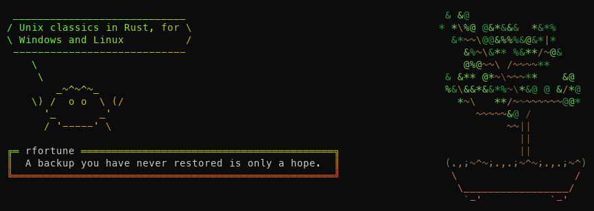

# fun_tools

Classic Unix terminal toys and tools, rewritten in Rust for **Windows and Linux**.
Every tool starts with **r** (for Rust).

[Português](README.pt.md)



| Tool | In the style of | What it does |
|---|---|---|
| `rfetch` | neofetch | System information next to a logo of the OS / shell ([details](docs/rfetch.md)) |
| `rcowsay`, `rcowthink` | cowsay | An animal says or thinks a message |
| `rlolcat` | lolcat | Rainbow-coloured text |
| `rboxes` | boxes | A box around text |
| `rfortune` | fortune | A random saying |
| `rbonsai` | cbonsai | Grows a random bonsai tree |
| `rmatrix` | cmatrix | Falling digital rain |
| `rsl` | sl | A steam train crosses the terminal |

## Build and install

```bash
cargo build --release
```

The programs are in `target/release/`. To install them all in `~/.cargo/bin`:

```bash
cargo install --path .
```

- **Windows:** needs the MSVC build tools (`link.exe`, `cl.exe`) in the environment.
- **Linux:** needs a C compiler (`gcc` or `clang`), used by rfetch's TLS library.

`test.bat` (Windows) and `test.sh` (Linux) build everything and run a short demo of each tool.

## Common to all the tools

- `-h, --help` and `-V, --version`.
- `--lang <code>`: language of the messages, `en`, `pt` or `es`. Also `RTOOLS_LANG`;
  otherwise the system language, and English when it is none of these.
- Colours only go to a terminal (unless `--force`/`--color`) and never with `NO_COLOR`.
  The colour depth is detected (24-bit, 256 or 16 colours); `RTOOLS_COLORS=16|256|truecolor`
  forces it.
- Widths are measured in terminal columns: accents, CJK and emoji keep boxes and balloons straight.
- Text piped from Windows PowerShell loses its byte-order mark; `\r\n` line endings are fine.
- Usage errors exit with code 2, other errors with 1.

## The tools

### rcowsay / rcowthink

```bash
rcowsay "Hello"                    # message from the arguments
rfortune | rcowsay -f cat          # or piped in
rcowthink -f owl -d "..."          # think, with dead eyes
rcowsay -l                         # animals: cow, calf, sheep, cat, owl, crab, ghost
```

Options: `-f` animal, `-r` random animal, `-e` eyes, `-T` tongue, `-W` wrap width (40),
`-n` no wrapping, and the looks `-b -d -g -p -s -t -w -y`.

### rlolcat

```bash
rfortune | rlolcat
rlolcat -a file.txt                # animated
rcowsay hi | rlolcat -f | rboxes   # --force: colours into a pipe
```

Reads line by line, as the text arrives. Options: `-p` spread, `-F` frequency, `-S` seed,
`-i` colour the background, `-a`/`-d`/`-s` animation, `-f` force colours.

### rboxes

```bash
echo "Hello" | rboxes double
rboxes -s bold -a c -p 2 -t Title file.txt
rboxes --list
```

Styles: round, single, double, bold, dashed, block, shadow, classic, stars, hash, markdown.
Options: `-a` align (l/c/r), `-p`/`-P` padding, `-w` minimum width, `-t` title,
`-c` border colour (or `rainbow`).

### rfortune

```bash
rfortune                           # built-in sayings, in the current language
rfortune -s                        # short ones only
rfortune -m rust                   # every saying with "rust"
rfortune my-fortunes.txt folder/   # fortune files (entries separated by a "%" line)
rfortune --system                  # Linux: also /usr/share/games/fortunes
```

`RFORTUNE_PATH` (a list of files/folders) is used when no file is given.

### rbonsai

```bash
rbonsai                            # print a tree
rbonsai -l                         # watch it grow
rbonsai -s 42 -M 8 -b 2            # seed, more branches, small pot
```

The same seed gives the same tree (`-v` prints it). `-L` trunk length, `-W`/`-H` size.

### rmatrix

```bash
rmatrix
rmatrix -c rainbow -s 8 -k         # rainbow, fast, with katakana
```

q, Esc or Ctrl+C quit; the keys 1 to 9 change the speed. The screen is only redrawn
where it changes, so it does not flicker.

### rsl

```bash
rsl
rsl -l -F                          # a little flying train
rsl -n 5                           # five carriages
```

q, Esc or Ctrl+C stop it.

## Project structure

```text
src/lib.rs        shared code: cli, i18n, input, rng, term (colours), text (widths), tui
src/cow.rs        rcowsay and rcowthink
src/bin/*.rs      one file per tool
src/bin/rfetch/   rfetch (several modules)
tools/            rfetch logo generator
docs/             images, rfetch documentation
```

## Languages

Each tool keeps its texts in one table per language (English, European Portuguese,
Spanish); missing texts fall back to English. The list of languages is `LANGS` in
`src/i18n.rs`.
