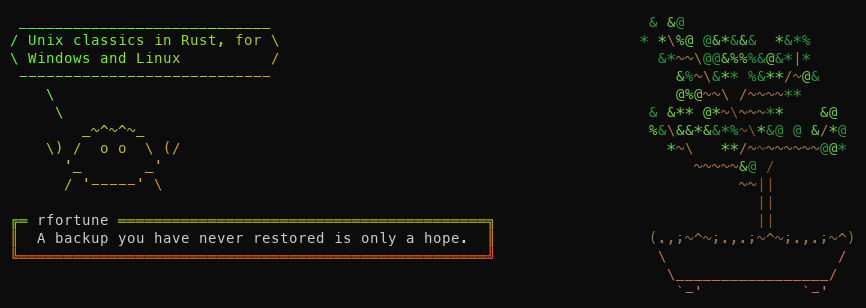
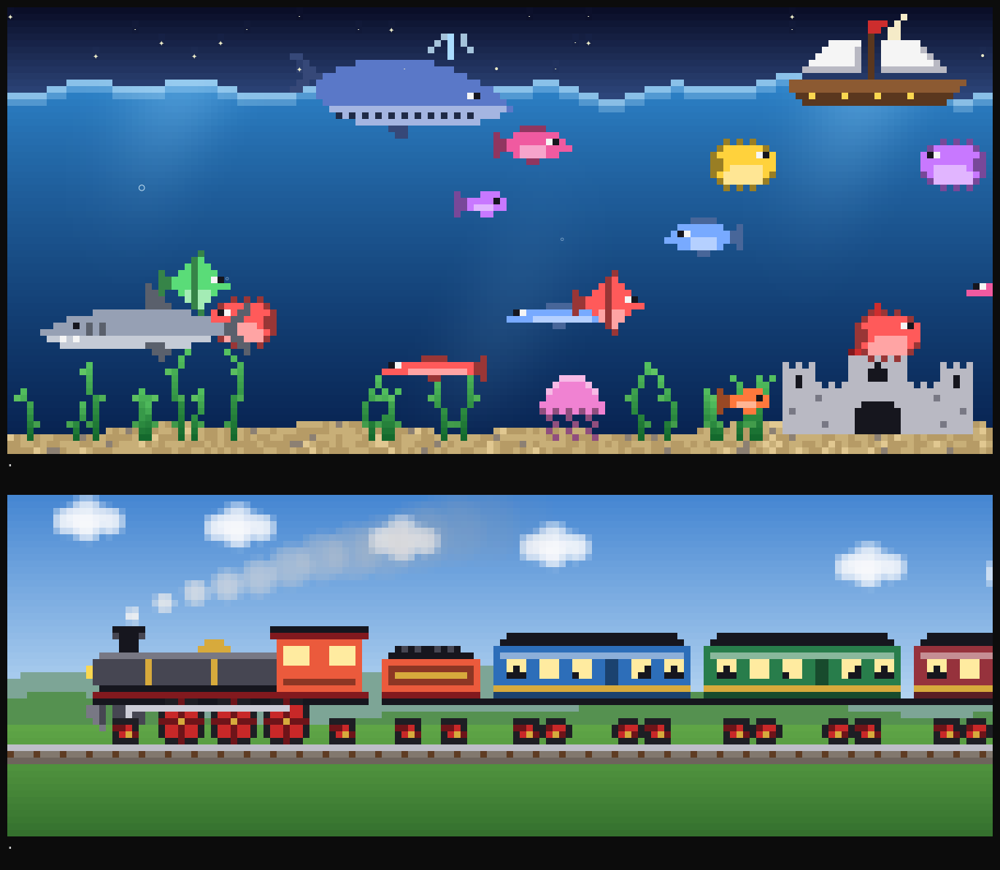
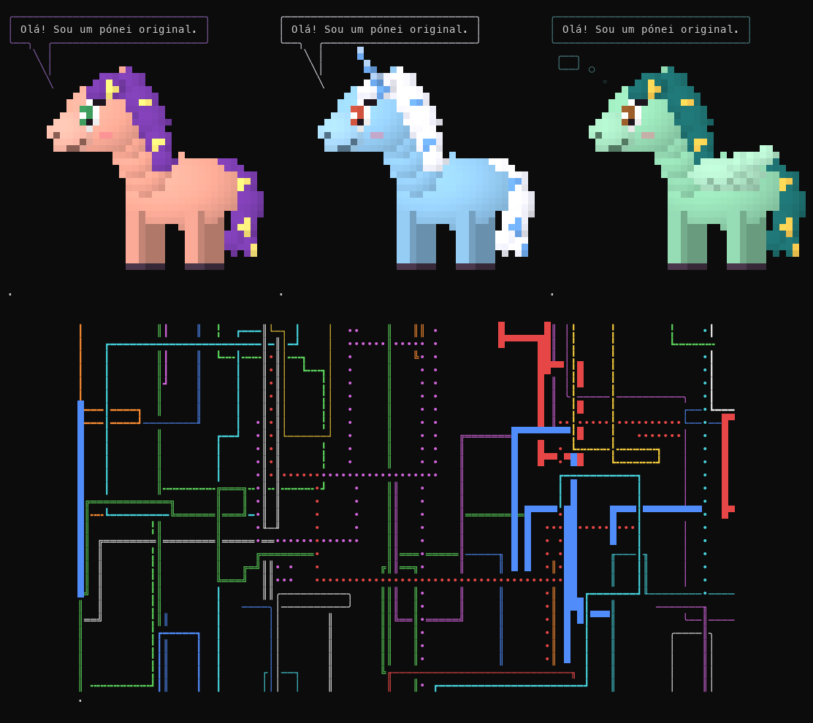
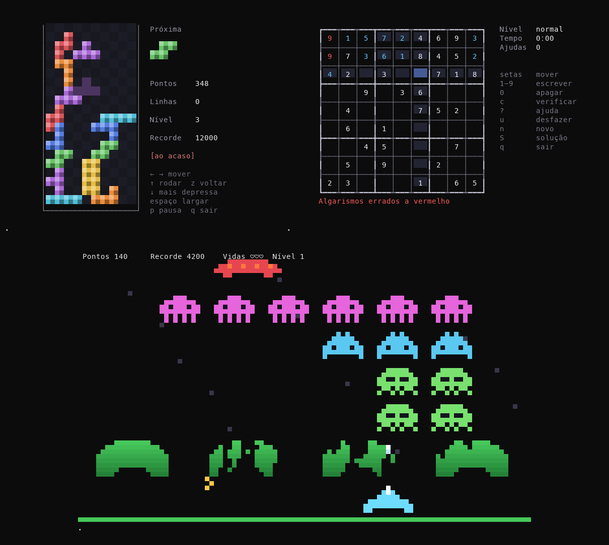

# fun_tools

Brinquedos e ferramentas clássicos do terminal Unix, reescritos em Rust para **Windows e Linux**.
Todas as tools começam por **r** (de Rust).

[English](README.md)



| Tool | Ao estilo de | O que faz |
|---|---|---|
| `rfetch` | neofetch | Informação do sistema ao lado de um logótipo do SO / shell ([detalhes](docs/rfetch.pt.md)) |
| `rcowsay`, `rcowthink` | cowsay | Um animal diz ou pensa uma mensagem |
| `rlolcat` | lolcat | Texto com as cores do arco-íris |
| `rboxes` | boxes | Uma caixa à volta do texto |
| `rfortune` | fortune | Uma frase ao acaso |
| `rbonsai` | cbonsai | Faz crescer um bonsai ao acaso |
| `rmatrix` | cmatrix | Chuva digital a cair |
| `rsl` | sl | Um comboio a vapor atravessa o terminal |
| `rfiglet` | figlet | Letras grandes feitas de caracteres |
| `rtoilet` | toilet | Letras grandes e coloridas, com filtros |
| `rtty-clock` | tty-clock | Um relógio digital grande |
| `rasciiquarium` | asciiquarium | Um aquário: peixes, tubarões, uma baleia, um barco... |
| `rnyancat` | nyancat | Um gato com corpo de bolo voa pelo espaço num arco-íris |
| `rpipes` | pipes.sh | Canos crescem pelo terminal e viram ao acaso |
| `rnms` | no-more-secrets | Texto baralhado que se desencripta, como nos filmes |
| `rponysay` | ponysay | Um pónei em pixel art diz ou pensa uma mensagem |
| `rgenact` | genact | Atividade a fingir: compilações, arranques, descargas, instalações |
| `rhollywood` | hollywood | Painéis com atividade de "hacker" muito ocupada, como nos filmes |
| `rblocks` | bastet | Blocos a cair; o modo maldoso dá sempre a peça de que menos precisa |
| `rinvaders` | ninvaders | Abata as filas de invasores antes que aterrem |
| `rsudoku` | nudoku | Sudoku: puzzles com uma só solução, em quatro dificuldades, ou impressos |
| `rrig` | rig | Identidades fictícias ao acaso para dados de teste |

Todos os desenhos, fontes, frases e dados são originais; também se podem usar as fontes
FIGlet/TOIlet instaladas no sistema.

## Transferir

Os programas prontos a usar para Windows e Linux estão na
[página das versões](https://github.com/mcampilho/fun_tools/releases):

- `fun_tools-vX.Y.Z-windows-x86_64.zip`: Windows 10/11 (64 bits). Não é preciso instalar mais nada.
- `fun_tools-vX.Y.Z-linux-x86_64.tar.gz`: qualquer distribuição Linux de 64 bits (binários estáticos).

Descompacte e ponha a pasta no `PATH` (ou corra as tools a partir dela). Para confirmar que um
ficheiro chegou intacto, compare o seu SHA-256 com o `SHA256SUMS.txt` da mesma versão:

```bash
sha256sum -c SHA256SUMS.txt --ignore-missing                                  # Linux
```

```powershell
Get-FileHash .\fun_tools-vX.Y.Z-windows-x86_64.zip -Algorithm SHA256       # Windows
```

Cada ficheiro tem também uma atestação de origem: a prova de que foi o GitHub a compilá-lo a
partir deste repositório. Com a GitHub CLI:

```bash
gh attestation verify fun_tools-vX.Y.Z-linux-x86_64.tar.gz --repo mcampilho/fun_tools
```

Uma nova versão faz-se acertando a versão no `Cargo.toml`, fazendo commit e enviando uma tag
com a mesma versão (`git tag vX.Y.Z && git push origin vX.Y.Z`); o
[workflow de release](.github/workflows/release.yml) compila, testa e publica.

Para fazer os mesmos pacotes no seu PC (Windows com as ferramentas MSVC e o WSL para o Linux),
corra `tools\release.ps1`: compila e testa os dois e deixa-os, com o `SHA256SUMS.txt`, em
`dist\`. `-NoTest`, `-NoLinux` e `-NoWindows` saltam partes; `-Publish` cria uma versão em
rascunho no GitHub, para uma versão que ainda lá não esteja. A parte Linux precisa, uma vez,
de `sudo apt install musl-tools` no WSL (ou corra `sh tools/release-linux.sh vX.Y.Z` em Linux).
Os pacotes locais não têm atestação de origem, por isso as versões oficiais vêm do workflow.
## Compilar e instalar

```bash
cargo build --release
```

Os programas ficam em `target/release/`. Para os instalar todos em `~/.cargo/bin`:

```bash
cargo install --path .
```

- **Windows:** precisa das ferramentas de compilação MSVC (`link.exe`, `cl.exe`) no ambiente.
- **Linux:** precisa de um compilador de C (`gcc` ou `clang`), usado pela biblioteca de TLS do rfetch.

As tools de ecrã inteiro (rmatrix, rsl, rtty-clock, rasciiquarium, rnyancat, rpipes, rhollywood) e os jogos precisam de um terminal.

`test.bat` (Windows) e `test.sh` (Linux) compilam tudo e mostram uma pequena demonstração de cada tool.

## Comum a todas as tools

- `-h, --help` e `-V, --version`.
- `--lang <código>`: idioma das mensagens, `en`, `pt` ou `es`. Também `RTOOLS_LANG`;
  senão, o idioma do sistema, e inglês quando não é nenhum destes.
- As cores só vão para um terminal (a não ser com `--force`/`--color`) e nunca com `NO_COLOR`.
  A profundidade de cor é detetada (24 bits, 256 ou 16 cores); `RTOOLS_COLORS=16|256|truecolor`
  força-a.
- As larguras são medidas em colunas do terminal: acentos, CJK e emoji mantêm as caixas e os
  balões direitos.
- O texto recebido por pipe do Windows PowerShell perde a marca de ordem dos bytes (BOM); os fins
  de linha `\r\n` não causam problemas.
- Os erros de utilização terminam com o código 2, os outros erros com 1.

## As tools

### rcowsay / rcowthink

```bash
rcowsay "Olá"                      # mensagem nos argumentos
rfortune | rcowsay -f cat          # ou recebida por pipe
rcowthink -f owl -d "..."          # pensar, com olhos de morto
rcowsay -l                         # animais: cow, calf, sheep, cat, owl, crab, ghost
```

Opções: `-f` animal, `-r` animal ao acaso, `-e` olhos, `-T` língua, `-W` largura de quebra (40),
`-n` sem quebra de linhas, e os aspetos `-b -d -g -p -s -t -w -y`.

### rlolcat

```bash
rfortune | rlolcat
rlolcat -a ficheiro.txt            # animado
rcowsay olá | rlolcat -f | rboxes  # --force: cores para um pipe
```

Lê linha a linha, à medida que o texto chega. Opções: `-p` espalhamento, `-F` frequência,
`-S` semente, `-i` colorir o fundo, `-a`/`-d`/`-s` animação, `-f` forçar as cores.

### rboxes

```bash
echo "Olá" | rboxes double
rboxes -s bold -a c -p 2 -t Título ficheiro.txt
rboxes --list
```

Estilos: round, single, double, bold, dashed, block, shadow, classic, stars, hash, markdown.
Opções: `-a` alinhamento (l/c/r), `-p`/`-P` margens, `-w` largura mínima, `-t` título,
`-c` cor da moldura (ou `rainbow`).

### rfortune

```bash
rfortune                           # frases embutidas, no idioma atual
rfortune -s                        # só as curtas
rfortune -m rust                   # todas as frases com "rust"
rfortune frases.txt pasta/         # ficheiros fortune (entradas separadas por uma linha "%")
rfortune --system                  # Linux: também /usr/share/games/fortunes
```

`RFORTUNE_PATH` (uma lista de ficheiros/pastas) é usado quando não se indica nenhum ficheiro.

### rbonsai

```bash
rbonsai                            # mostrar uma árvore
rbonsai -l                         # vê-la crescer
rbonsai -s 42 -M 8 -b 2            # semente, mais ramos, vaso pequeno
rbonsai -u -f blossom -l           # aspeto Unicode, em flor (ver abaixo)
```

A mesma semente dá a mesma árvore (`-v` mostra-a). `-L` comprimento do tronco, `-W`/`-H` tamanho.
Com `-u`, `-f` escolhe as folhas: green (verde), autumn (outono), blossom (em flor) ou random.

### rmatrix

```bash
rmatrix
rmatrix -c rainbow -s 8 -k         # arco-íris, rápido, com katakana
```

q, Esc ou Ctrl+C para sair; as teclas de 1 a 9 mudam a velocidade. O ecrã só é redesenhado onde
muda, por isso não cintila.

### rsl

```bash
rsl
rsl -l -F                          # um comboio pequeno a voar
rsl -n 5                           # cinco carruagens
rsl -u                             # aspeto Unicode (ver abaixo)
```

q, Esc ou Ctrl+C para o parar.

### rfiglet / rtoilet

```bash
rfiglet "Olá"                      # "standard" se estiver instalada, senão a "hash" embutida
rfiglet -f pixel -c "Olá, Ação!"   # as fontes embutidas têm as letras acentuadas
rtoilet --gay "Arco-íris"          # rtoilet: fonte embutida "pixel" e filtros de cor
rtoilet -f tiny -F border:metal "Tiny"
rfiglet -L                         # fontes: embutidas e instaladas
```

Fontes embutidas: pixel, tiny, hash, shade, drop (desenhadas a partir de uma fonte de
pixels original, com as letras acentuadas do português, do espanhol e de outras línguas
ocidentais). As fontes FIGlet `.flf` e TOIlet `.tlf` são procuradas pelo nome em
`FIGLET_FONTDIR`, `TOILET_FONT_PATH`, numa pasta `fonts` ao lado do programa,
`%LOCALAPPDATA%\rfiglet\fonts` (Windows), `~/.local/share/rfiglet/fonts` e `/usr/share/figlet`
(Linux), ou indicadas como ficheiro; são seguidas as suas regras de encaixe e fusão. Opções:
`-w` largura, `-c`/`-l`/`-r` alinhamento, `-k` encaixe, `-W` largura total, `-s` fusão; o
rtoilet tem também `-F` filtros (crop, rainbow/gay, metal, fire, flip, flop, rotate, border).

### rtty-clock

```bash
rtty-clock -s                      # com segundos
rtty-clock -t -C cyan -x           # 12 horas, ciano, numa caixa
rtty-clock -r -S                   # protetor de ecrã aos saltos: qualquer tecla sai
```

Teclas: q sair, s segundos, t 12/24 h, d data, r saltar, x caixa, b dois pontos a piscar,
1 a 8 cor. A data é escrita no idioma escolhido (ou no formato strftime de `-f`). Os
algarismos são células coloridas, por isso não têm riscos entre linhas.

### rasciiquarium

```bash
rasciiquarium
rasciiquarium -n 9 -s 7            # mais peixes, mais depressa
rasciiquarium -u                   # aspeto Unicode (ver abaixo)
```

Peixes de vários tipos nadam para os dois lados e deitam bolhas, as algas ondulam e, de
vez em quando, passa um tubarão (come os peixes pequenos), uma baleia com o seu repuxo, um
barco ou uma medusa. Teclas: q sair, p pausa, r recomeçar.

### O aspeto Unicode (`-u`) do rasciiquarium, do rsl e do rbonsai



Com `-u, --unicode`, tudo passa a pixel art a cores: cada célula do terminal mostra dois
pixels quadrados com os meios blocos `▀ ▄`, e alguns símbolos ficam por cima (bolhas `○ ◦`,
estrelas `✦ · ∙`). O aquário ganha um céu noturno com quarto crescente, ondas, raios de luz,
um fundo de areia e criaturas em pixels. O comboio ganha um tender, carruagens com
passageiros, rodas que giram com bielas, fumo a subir e uma paisagem com nuvens, colinas e a
via. O bonsai ganha um tronco sombreado em S, ramos com nuvens de folhas (verdes, de outono
ou em flor) e um vaso vidrado com terra e musgo; também pode crescer ao vivo (`-l`).
É uma opção porque precisa de uma fonte com estes caracteres (Cascadia, Consolas,
DejaVu Sans Mono, Meslo, as Nerd Fonts...) e fica melhor com cor de 24 bits (Windows
Terminal, a maioria dos terminais Linux); com 256 ou 16 cores, as cores são aproximadas.

### rnyancat

```bash
rnyancat
rnyancat -n -s 2                   # sem contador, pixels do desenho duas vezes maiores
rnyancat -f 100                    # parar ao fim de 100 imagens
```

Um gato com corpo de bolo voa por um céu estrelado, com um arco-íris atrás: sobe e desce,
mexe as patas e a cauda, e as estrelas cintilam ao passar. O contador em baixo diz há
quanto tempo está a voar (`-n` esconde-o). O desenho é original e é sempre feito no
aspeto Unicode, ampliado para caber no terminal (ou `-s`). `-d` dá o tempo de cada
imagem. q, Esc ou Ctrl+C para sair.

### rpipes

```bash
rpipes
rpipes -p 5 -t 1 -t 2 -R           # cinco canos, finos e redondos, em sítios ao acaso
rpipes -t c"|-++++" -s 5           # peças à escolha, mais às voltas
rpipes -l                          # os estilos
```

Estilos: heavy, light, rounded, double, dashed, mixed, blocks, dots, ascii (`-t 0` a `-t 8`).
Opções: `-p` canos, `-f` passos por segundo, `-s` quão direitos, `-r` limpar ao fim de tantas
peças, `-R` começar ao acaso, `-K` manter a cor e o estilo ao passar a borda, `-B` sem negrito,
`-C` sem cores. Teclas: q sair, espaço limpar, 1 a 9 velocidade.

### rnms

```bash
echo "O segredo é 42" | rnms       # baralhado, uma tecla e depois desencriptado
ls -l | rnms -a -f green           # desencriptar logo, a verde
rnms -u "Muito secreto"            # baralhar também com símbolos de blocos e geométricos
```

O texto fica no ecrã no fim. Opções: `-a` sem tecla, `-s` baralhar também os espaços,
`-f` cor, `-c` limpar o ecrã primeiro, `-t` segundos a baralhar. Sem texto, mostra uma pequena
demonstração.

### rponysay

```bash
rponysay "Olá!"
rfortune | rponysay -k unicorn -f lilac
rponysay -t -k pegasus "Hmm..."    # pensar
rponysay -l                        # pelagens e tipos
```



Os póneis são pixel art original desenhada pelo programa (não são as personagens do ponysay
original): três tipos (pony, unicorn, pegasus) e oito pelagens (coral, lilac, azure, lemon,
jade, plum, snow, cocoa), escolhidos ao acaso se não forem indicados. A mensagem vai numa caixa
de cantos arredondados, com a moldura num tom da crina, e um bico até à cara do pónei ou, com
`-t`, bolhas de pensamento. `-W` largura, `-n` sem quebra de linhas, `-s` semente.

### rgenact

```bash
rgenact                            # um módulo atrás do outro, sem parar
rgenact -m cargo -m docker -s 2    # só estes, duas vezes mais depressa
rgenact --exit-after-time 60
rgenact -l
```

Módulos: cargo, bootlog, kernel, docker, download, memdump, packages, terraform, ansible,
weblog, hashcrack, loading. É tudo inventado: nomes, hashes e endereços (só das gamas
reservadas para documentação). Ctrl+C para parar.

### rhollywood

```bash
rhollywood
rhollywood -p 4 -i 5               # quatro painéis, um muda a cada 5 s
```

Painéis: memória, código a compilar, registo do sistema, ligações de rede, lista de
processos, medidores de CPU, barras de desencriptação, um osciloscópio e um fluxo de
algarismos. É tudo inventado. Teclas: q sair, espaço baralhar.

### Os jogos: rblocks, rinvaders, rsudoku



Os jogos são originais: partilham o género e as regras com os clássicos, não os nomes,
os desenhos nem o aspeto.

```bash
rblocks                            # modo maldoso, como o bastet
rblocks -m random -L 5             # peças justas, a partir do nível 5
rinvaders
rsudoku -d hard
rsudoku -p 4 -d expert --solution > sudokus.txt   # puzzles para papel
```

- **rblocks**: ← → mover, ↑ rodar, z rodar ao contrário, ↓ mais depressa, espaço largar,
  p pausa. Modos (`-m`): `evil` (por omissão; cada peça nova é a que menos lhe convém),
  `random` (justo, em conjuntos de sete baralhados, com a próxima peça à vista) e `nice`
  (a peça que mais ajuda). `-G` esconde onde a peça vai cair.
- **rinvaders**: ← → mover, espaço disparar, p pausa. A formação acelera à medida que
  encolhe; os escudos desfazem-se; o disco voador vale uma surpresa. Uma vida extra aos
  1500 pontos; cada nível começa mais abaixo. `-L` nível inicial. O número de filas de
  invasores depende da altura do terminal (de 2 a 5).
- **rsudoku**: setas ou h j k l mover, 1-9 escrever, 0 apagar, c verificar, ? ajuda,
  u desfazer, n novo puzzle, S solução. Os conflitos aparecem logo a vermelho. Cada puzzle
  é feito na hora e tem uma só solução; `-s` repete um.

O rblocks e o rinvaders guardam os dez melhores resultados (`-S` mostra-os) em
`%LOCALAPPDATA%\rtools` (Windows) ou `~/.local/share/rtools` (Linux); `RTOOLS_DATA` escolhe
outra pasta. Em todos os jogos, q ou Esc sai e n recomeça depois de um jogo acabar.

### rrig

```bash
rrig                               # uma identidade, país conforme o idioma
rrig -C pt -c 5 -e                 # cinco identidades portuguesas, com e-mail
rrig -C es -o csv -c 100 > teste.csv
rrig -o json -s 42                 # as mesmas identidades outra vez, com a mesma semente
```

Países: us, pt, es. É tudo fictício: os telefones dos EUA usam a gama 555-01xx, reservada
para ficção, e os e-mails usam os domínios example.com/.org/.net.

## Origens

Todas as tools daqui são programas novos, escritos de raiz, com desenhos e textos originais;
nenhum código vem dos originais. Estes são os clássicos que as inspiraram, com um
agradecimento aos seus autores.

| Tool | Inspirada em | Autor(es) | Primeira versão | Página |
|---|---|---|---|---|
| rfetch | neofetch, screenFetch | Dylan Araps; Brett Bohnenkamper | 2015 (arquivado em 2024); 2010 | [neofetch](https://github.com/dylanaraps/neofetch), [screenFetch](https://github.com/KittyKatt/screenFetch) |
| rcowsay, rcowthink | cowsay | Tony Monroe; mantido desde 2016 por Andrew Janke | 1999 | [cowsay-org/cowsay](https://github.com/cowsay-org/cowsay) |
| rlolcat | lolcat | Moe (busyloop) | 2011 | [busyloop/lolcat](https://github.com/busyloop/lolcat) |
| rboxes | boxes | Thomas Jensen | 1999 | [boxes.thomasjensen.com](https://boxes.thomasjensen.com/) |
| rfortune | fortune | Ken Arnold (BSD fortune) | 1979 (Version 7 Unix) | [fortune-mod](https://github.com/shlomif/fortune-mod) |
| rbonsai | cbonsai | John Allbritten (a partir do seu bonsai.sh, de 2019) | 2020 | [jallbrit/cbonsai](https://gitlab.com/jallbrit/cbonsai) |
| rmatrix | cmatrix | Chris Allegretta; mantido por Abishek V. Ashok | 1999 | [abishekvashok/cmatrix](https://github.com/abishekvashok/cmatrix) |
| rsl | sl | Toyoda Masashi | 1993 | [mtoyoda/sl](https://github.com/mtoyoda/sl) |
| rfiglet | FIGlet | Glenn Chappell e Ian Chai; mantido por Claudio Matsuoka | 1991 ("newban"), 1993 (FIGlet 2.0) | [figlet.org](http://www.figlet.org/) |
| rtoilet | TOIlet | Sam Hocevar (projeto libcaca) | 2006 | [caca.zoy.org/wiki/toilet](http://caca.zoy.org/wiki/toilet) |
| rtty-clock | tty-clock | Martin Duquesnoy (xorg62) | 2008 | [xorg62/tty-clock](https://github.com/xorg62/tty-clock) |
| rasciiquarium | Asciiquarium | Kirk Baucom | 2005 (1.0: 2 de setembro de 2005) | [robobunny.com](https://robobunny.com/projects/asciiquarium/html/) |
| rnyancat | nyancat | Kevin Lange (klange); a animação Nyan Cat é de Christopher Torres (prguitarman), abril de 2011 | 2011 | [klange/nyancat](https://github.com/klange/nyancat) |
| rhollywood | hollywood | Dustin Kirkland | 2014 | [dustinkirkland/hollywood](https://github.com/dustinkirkland/hollywood) |
| rrig | rig (Random Identity Generator) | Ian Turner, a partir do programa de MS-DOS "fake" | 1999 | [rig.sourceforge.net](https://rig.sourceforge.net/) |
| rpipes | pipes.sh | Matthew Simpson (fóruns do Arch Linux); Yu-Jie Lin; Pipeseroni desde 2015 | 2010 | [pipeseroni/pipes.sh](https://github.com/pipeseroni/pipes.sh) |
| rponysay | ponysay | Erkin Batu Altunbaş, com Mattias Andrée e outros | 2012 | [erkin/ponysay](https://github.com/erkin/ponysay) |
| rnms | no-more-secrets | Brian Barto (bartobri); o efeito vem do filme *Sneakers* (1992) | 2016 | [bartobri/no-more-secrets](https://github.com/bartobri/no-more-secrets) |
| rgenact | genact | Sven-Hendrik Haase (svenstaro) | 2018 (primeira versão no crates.io) | [svenstaro/genact](https://github.com/svenstaro/genact) |
| rblocks | bastet ("bastard tetris") | Federico Poloni, a partir do Petris de Peter Seidler | 2004 | [bastet](https://fph.altervista.org/prog/bastet.html) |
| rinvaders | nInvaders | Thomas Dettbarn | 2002 | [ninvaders.sourceforge.net](http://ninvaders.sourceforge.net/) |
| rsudoku | nudoku | Michael Vetter (jubalh) | 2015 (no GitHub) | [jubalh/nudoku](https://github.com/jubalh/nudoku) |

Notas sobre as datas: o ano é o da primeira versão pública quando se conhece (pela história,
pelo registo de alterações ou pela página de manual do próprio projeto); senão, o vestígio mais
antigo encontrado. Para o nInvaders, o bastet e o nudoku é uma estimativa a partir do aviso de
direitos de autor, do pacote ou do repositório mais antigos; o código do tty-clock tem direitos
de autor de 2008. O fortune apareceu com o Version 7 Unix em 1979; o fortune do BSD, de Ken
Arnold, é o que a maioria dos sistemas usa hoje. Os nomes, as personagens e os desenhos dos
jogos originais não são usados.

## Estrutura do projeto

```text
src/lib.rs        código comum: cli, i18n, input, rng, term (cores), text (larguras), tui
src/cow.rs        rcowsay e rcowthink
src/fig.rs        rfiglet e rtoilet (layout FIGlet, fontes, filtros)
src/pixfont.rs    a fonte de pixels original (fontes embutidas, rtty-clock)
src/bin/*.rs      um ficheiro por tool
src/bin/rfetch/   rfetch (vários módulos)
tools/            gerador dos logótipos do rfetch, scripts de release locais
docs/             imagens, documentação do rfetch
```

## Idiomas

Cada tool tem os seus textos numa tabela por idioma (inglês, português europeu, espanhol); os
textos em falta ficam em inglês. A lista de idiomas é `LANGS` em `src/i18n.rs`.

## Licença

MIT: ver [LICENSE](LICENSE).
