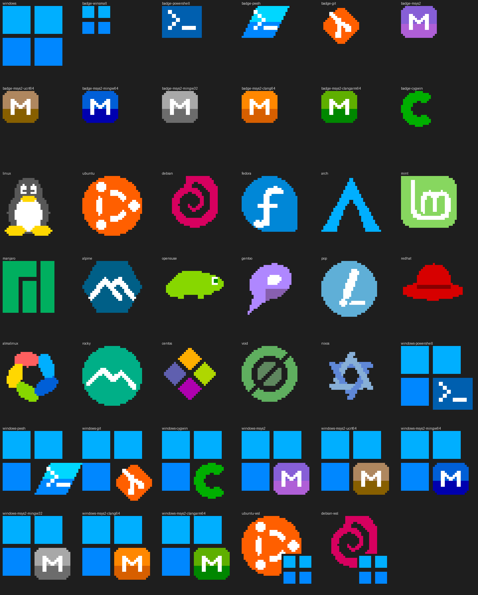

# rfetch

A fast, cross-platform (Windows and Linux) system information tool, in the style of neofetch.

[Português](rfetch.pt.md)

It shows: OS and architecture, kernel, uptime, shell, CPU, memory, system disk, Git user,
public IP, location and weather, time zone, locale and keyboard layout.

## Build

```bash
cargo build --release --bin rfetch
```

The binary is `target/release/rfetch` (`rfetch.exe` on Windows).

- **Windows:** needs the MSVC build tools (`link.exe`, `cl.exe`) in the environment.
- **Linux:** needs a C compiler (`gcc` or `clang`), used by the TLS library.

## Usage

```text
rfetch [options]

  -o, --offline       Do not use the network (no IP, location or weather)
  -r, --refresh       Ignore the cached network data and fetch it again
      --color         Always use colours
      --no-color      Never use colours (also: NO_COLOR environment variable)
  -l, --lang <code>   Language: en, pt, es (also: RFETCH_LANG, RTOOLS_LANG)
      --logo <name>   Use another logo (--logo list shows them all)
  -h, --help          Show this help
  -V, --version       Show the version
```

## Logos



Logos are pixel art in 256 colours: two pixels per character, with half blocks (`▀ ▄`)
and coloured cells. A character whose two pixels share a colour is a space on a coloured
background, not a `█`: in terminals whose font is shorter than the line (the classic
console, ConEmu, ConsoleZ), block glyphs leave thin dark lines between rows. Without
colours, `█ ▀ ▄` are used and the light details become holes so the shape stays readable.

Terminals with special handling:

- **ConsoleZ** only shows the 16 basic colours, so the logo uses them.
  `RFETCH_COLORS=16` (or `256`) forces either mode in any terminal.
- **MobaXterm** reads the output of Windows programs in the system's OEM code page
  (850, 437, ...) instead of UTF-8, even when its console is set to UTF-8, so the text is
  written in that code page.

The logo is chosen automatically:

| Where it runs | Logo |
|---|---|
| Windows PowerShell 5.1 | Windows + PowerShell 5.1 badge |
| PowerShell 7 | Windows + PowerShell 7 badge |
| Git Bash, Git CMD | Windows + Git badge |
| MSYS2 | Windows + MSYS2 badge in the colour of each environment (MSYSTEM): MSYS purple, UCRT64 brown, MINGW64 blue, MINGW32 grey, CLANG64 orange, CLANGARM64 green |
| Cygwin | Windows + Cygwin badge |
| cmd, others | Windows |
| Linux | Logo of the distribution: Ubuntu, Debian, Mint, Pop!_OS, Fedora, Red Hat, AlmaLinux, Rocky Linux, CentOS, Arch (also EndeavourOS), Manjaro, Alpine, openSUSE, Gentoo, Void, NixOS; Tux for the others |
| WSL | Distribution logo + small Windows badge |

The environment is found from the parent processes: the nearest shell and the folder its
executable lives in (Git for Windows, MSYS2 and Cygwin installations have their own marker
files). `--logo <name>` forces any logo, e.g. `--logo windows-git` or `--logo debian-wsl`.

The logos are generated by `tools/rfetch_logos.py` (simple shapes → text grids in
`src/bin/rfetch/logo/art.rs`, plus a preview image):

```bash
python3 tools/rfetch_logos.py docs/rfetch-logos.png src/bin/rfetch/logo/art.rs
```

## Speed and robustness

- Local data takes a few tens of milliseconds. Only what is shown is read: no full
  process list, and the CPU name comes from the CPUID instruction (sysinfo's CPU list
  takes 0.5 s or more on Windows).
- The network runs in the background while local data is collected, with short timeouts
  and an overall limit of 3.5 s. If it does not answer in time, those lines are left out.
- IP, location and weather are cached for 15 minutes
  (`%LOCALAPPDATA%\rfetch\net.json` on Windows, `~/.cache/rfetch/net.json` on Linux).
- Location tries several providers in turn: ipwho.is, ipapi.co, ip-api.com.
  Weather comes from open-meteo.com.
- Any missing piece of information is skipped instead of stopping the program.
- Writing to a closed pipe (`rfetch | head`) does not cause a panic.

## Privacy

Without `--offline`, your public IP is sent to the location provider and your approximate
coordinates to open-meteo.com.

## Languages

Program texts live in `src/i18n.rs`, one table per language (English, European Portuguese,
Spanish); missing texts fall back to English. The language comes from `--lang`, then
`RFETCH_LANG`, then `RTOOLS_LANG` (shared by all the tools), then the system locale. To add a language, add it to `Lang`, to `LANGS`
and write its table.
